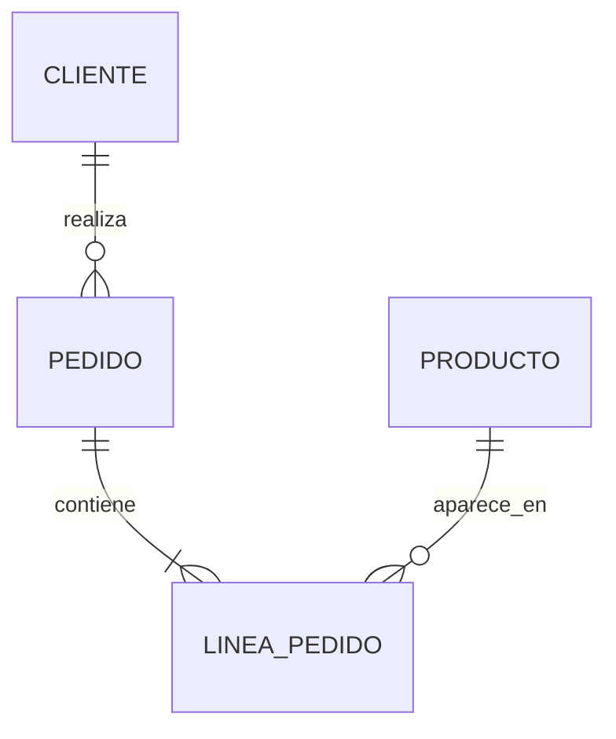

# ej02 · CRUD en SQL

**Unidad:** UT2 · **Sesión:** 2 · **CE que evidencia:** c, e, f (parte de datos) · **Tiempo:** ~1 h 45 min · **Dónde:** clase y casa · **Apuntes previos:** [04](../../apuntes/04-modelo-relacional.md), [05](../../apuntes/05-crud-y-guia-sql.md) y [06](../../apuntes/06-transacciones.md) · **Antes:** haber hecho el [ej01](../ej01-servidor-y-dbeaver/README.md)

## Tu misión

La tienda ya sabe de productos; ahora tiene **clientes y pedidos**. Te toca ser analista: con SQL puro, en DBeaver, vas a responder diez preguntas sobre los datos. Sin Java todavía.

## Antes de empezar

- [ ] El servidor del ej01 está en `healthy` y DBeaver conectado.
- [ ] No hace falta reiniciar nada: el script del paso 1 **recrea también la tabla `producto`** con los datos del ejercicio, así que siempre partes del mismo estado.

## Paso 1 · Crea el esquema

Abre [`00-esquema.sql`](00-esquema.sql) en DBeaver (menú *File → Open File…*) y ejecútalo entero (**Alt+X**). Crea `cliente`, `pedido` y `linea_pedido` con datos. Si lo ejecutas otra vez, **borra y vuelve a crear** esas tres tablas: es seguro repetirlo.

Antes de seguir, **mira** las tablas: ¿qué son las PK y las FK de cada una? ¿Cuál es la tabla intermedia de una relación N:M?

## Paso 2 · Las diez preguntas

Crea un script `ej02.sql` y escribe una sentencia por pregunta. **Ejecútalas en orden**: algunas dependen de las anteriores. Cada una trae el resultado que deberías obtener.

| # | Pregunta | Debería salir |
|---|---|---|
| 1 | **(C)** Inserta el producto `Auriculares` a 39.95 (con punto decimal) y consulta el `id` que le ha tocado (`LAST_INSERT_ID()`). | Un id nuevo (en un servidor recién creado, el **4**). |
| 2 | **(R)** Nombre y precio de los productos de **más de 20 €**, del más caro al más barato. | Auriculares 39.95 · Teclado 26.25 |
| 3 | **(R)** ¿Cuántos pedidos ha hecho el cliente 1? | `2` |
| 4 | **(R · JOIN)** `id` y `fecha` de los pedidos del cliente con email `ana@ejemplo.es`, sin usar su `id`. | Pedidos 1 (2026-10-01 10:00) y 2 (2026-10-03 18:30) |
| 5 | **(R · JOIN)** Nombre del producto y cantidad de las líneas del pedido 1. | Teclado 1 · Ratón 2 |
| 6 | **(R · agregación)** El **total** de cada pedido: suma de `cantidad × precio` agrupada y **ordenada** por pedido. | Pedido 1: 30.00 · Pedido 2: 26.25 · Pedido 3: 25.00 |
| 7 | **(U)** Sube un 10 % el precio de los productos de **menos de 20 €** y consulta el Ratón. | Ratón 9.63 (y el Teclado de 12.50 pasa a 13.75) |
| 8 | **(D)** Borra el producto `Auriculares`. | 1 fila afectada |
| 9 | **(D, a propósito)** Intenta borrar el producto con `id = 1`. | **Error 1451**: está en líneas de pedido. Lee el mensaje. |
| 10 | **(Transacción)** `START TRANSACTION`; pon **todos** los precios a 0; consulta la tabla; `ROLLBACK`; consulta otra vez. | Primero todo a 0.00, después los precios que tenían justo antes del `START TRANSACTION`. |

> [!WARNING]
> En las preguntas 7, 8 y 10: **escribe el `WHERE` primero**, o prueba la condición con un `SELECT` antes de ejecutar la modificación (apunte 05). La 10 es la única donde un `UPDATE` sin `WHERE` es intencionado, y por eso va dentro de una transacción.

## Paso 3 · Explica (por escrito)

En un `ej02.md`, responde brevemente:

1. En la 9, ¿qué protegió a los datos: tu código, o la base de datos? ¿Qué restricción lo hizo?
2. En la 10, ¿qué habría pasado sin `START TRANSACTION`?
3. Escribe una sentencia que fallaría por el `CHECK` de `producto` y otra por el `UNIQUE` de `cliente.email`. Ejecútalas y pega el error.

> **didactico:** el total de un pedido se calcula con el precio **actual** del producto. En una tienda real `linea_pedido` guardaría también el precio de ese momento, porque si hoy subes un precio (pregunta 7), los totales de los pedidos antiguos cambiarían. Aquí lo dejamos fuera para no ampliar el esquema.

> **Al terminar:** este ejercicio deja los datos cambiados (el Ratón vale otro precio, hay tablas nuevas). Los ejercicios siguientes parten del estado inicial: vuelve a él con `docker compose down -v` y `docker compose up -d` en `mi-mysql`, y ejecuta de nuevo `00-esquema.sql` si el ej04 lo necesita.

## Cómo comprobarlo

Para la pregunta 6 te servirá el ejemplo de `GROUP BY` del [apunte 05](../../apuntes/05-crud-y-guia-sql.md). Compara cada resultado con la columna «Debería salir». Si algo no coincide, repasa el `JOIN` (¿falta la condición `ON`?) o el `WHERE`.

## Reto opcional

Lista los **clientes que no han hecho ningún pedido**. Pista: necesitarás un `LEFT JOIN` y mirar cuándo la parte derecha es `NULL`. (Debería salir solo Marta.)

> **Si te atascas:** [chuleta de SQL](../../refuerzos/01-chuleta-sql.md) · [transacciones](../../refuerzos/05-guia-transacciones.md) · [errores de MySQL](../../refuerzos/07-diagnostico-de-errores.md#2-errores-de-mysql-sql).

## Entrega

Sube `ej02.sql` y `ej02.md` a tu repositorio, en una rama `feat/ut02-ej02` (mismos pasos que en el ej01: `git switch -c`, `git add`, `git commit`, `git push -u origin …`).
