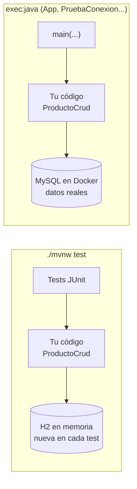

# ej03 · CRUD con JDBC

**Unidad:** UT2 · **CE que evidencia:** b, c, e, f (parte de datos), g · **Sesión:** 3 · **Tiempo:** ~1 h en clase (pasos 1-3) + ~30 min en casa (paso 4) · **Apuntes previos:** [07](../../apuntes/07-jdbc-conexion.md) y [08](../../apuntes/08-crud-con-jdbc.md) · El test de inyección SQL se entiende con el [09](../../apuntes/09-preparedstatement-e-inyeccion.md) (sesión 4)

## Tu misión

La tienda tiene una tabla `producto` y una clase [`ProductoCrud`](src/main/java/es/dwes/ut02/ProductoCrud.java) con seis métodos **vacíos**. Trece tests los vigilan y casi todos están en rojo. Tu misión: programar el CRUD con JDBC hasta ponerlos **en verde**.

**Figura · Dónde corre cada cosa.** Los tests usan H2 en memoria; cuando ejecutas `App` o tus pruebas manuales, hablas con el MySQL de Docker.



## Antes de empezar

- [ ] Has leído los apuntes 07 y 08.
- [ ] Tienes el MySQL del curso levantado desde tu carpeta `mi-mysql` ([apunte 02](../../apuntes/02-servidor-de-bd-y-contenedores.md)). **Los tests no lo necesitan** (usan H2 en memoria, una BD que vive en la memoria del programa), pero lo usarás en el paso 4.
- [ ] Una terminal dentro de esta carpeta. Usa `mvnw` como en la UT1 (`./mvnw` o `.\mvnw.cmd`).

> **Qué es nuevo y qué es repetición:** los `TODO` 1, 2, 3, 5 y 6 casi están resueltos en el apunte 08: aquí se trata de que los **escribas tú**. El nuevo de verdad es el **4** (`buscarPorNombre`, con su test de seguridad). Tras el paso 1, unos 2 tests ya pasan con el esqueleto vacío (comprueban «no existe»): es normal.

## Paso 1 · Predice

Ejecuta los tests **sin tocar nada**:

```bash
./mvnw test
```

Antes de mirar el resultado, apunta cuántos crees que fallarán. Después, lee **un** mensaje de fallo: dice qué esperaba el test (`expected`) y qué recibió (`but was`). Por ejemplo:

```text
[ERROR] Failures:
[ERROR]   ProductoCrudTest.listarDevuelveTodasLasFilasOrdenadasPorId:54 expected: <3> but was: <0>
```

Significa: el test esperaba 3 productos y `listar()` devolvió 0 (todavía es un `TODO`).

## Paso 2 · Lectura (R)

Abre `ProductoCrud.java` y resuelve, por este orden, los `TODO` de lectura: **2** (`buscarPorId`), **3** (`listar`) y **4** (`buscarPorNombre`).
Ejecuta `mvnw test` después de cada uno y fíjate en cuántos tests pasan a verde.

## Paso 3 · Escritura (C, U, D)

Resuelve los `TODO` **1** (`insertar`, con `RETURN_GENERATED_KEYS`), **5** (`actualizarPrecio`) y **6** (`eliminar`).

Reglas que los tests comprueban:

- Conexión, sentencia y resultado se abren con `try-with-resources`.
- Los valores van como parámetros `?`. El test `buscarPorNombreNoEsVulnerableAInyeccionSql` falla si concatenas.
- `actualizarPrecio` y `eliminar` devuelven `false` si el `id` no existe (mira cuántas filas afecta la sentencia).

## Paso 4 · Pruébalo contra MySQL de verdad

1. Con el contenedor `healthy`, copia `.env.example` a `.env` **en esta carpeta** y pon la contraseña de **tu** `mi-mysql/.env` (`MYSQL_PASSWORD`).
2. **Carga** esas variables en tu terminal (queda definida solo en esa terminal):

```bash
set -a; source .env; set +a        # Linux, macOS, Git Bash
```

```powershell
Get-Content .env | ForEach-Object { if ($_ -match '^\s*([^#=]+)=(.*)$') { Set-Item "env:$($matches[1])" $matches[2] } }   # PowerShell
```

3. Ejecuta `App`:

```bash
./mvnw -q compile exec:java            # PowerShell: .\mvnw.cmd -q compile exec:java
```

**Deberías ver:** la lista de los productos iniciales (si hiciste el ej02 antes, el Ratón costará otro precio y el id nuevo será mayor), el id del nuevo (el 4 en un servidor recién creado), el precio actualizado y, al final, `Optional.empty`. Comprueba también en DBeaver que el producto ya no está.

**Si falla:** `The url cannot be null` significa que no cargaste el `.env` (repite el punto 2 en la misma terminal); `Access denied`, que la contraseña no coincide; `Communications link failure`, que el servidor no está arrancado. Más en la tabla de errores del [apunte 07](../../apuntes/07-jdbc-conexion.md).

## Cómo comprobarlo

```bash
./mvnw test
```

**Deberías ver:** `Tests run: 13, Failures: 0, Errors: 0` y `BUILD SUCCESS`.

> **Aviso:** los tests usan H2, que **no es MySQL**: pueden diferir en tipos, números de id y mensajes de error. Por eso el paso 4 es obligatorio: es la prueba real.

## Reto opcional

1. Añade `listarPorPrecioMaximo(BigDecimal maximo)` con su propio test: productos que cuestan **como máximo** ese valor.
2. Escribe un test que demuestre qué pasaría si `buscarPorNombre` concatenara el texto. ¿Cómo lo harías fallar a propósito sin romper tu código bueno?

> **Si te atascas:** [chuleta de JDBC](../../refuerzos/04-chuleta-jdbc.md) · [guía de Maven](../../refuerzos/03-guia-maven.md) · [leer los tests y depurar](../../refuerzos/08-leer-tests-y-depurar.md) · [diagnóstico de errores](../../refuerzos/07-diagnostico-de-errores.md).

## Entrega

Sube la carpeta del ejercicio (sin `target/` ni `.env`) a tu repositorio de la asignatura, en una rama `feat/ut02-ej03`, y abre un pull request.
