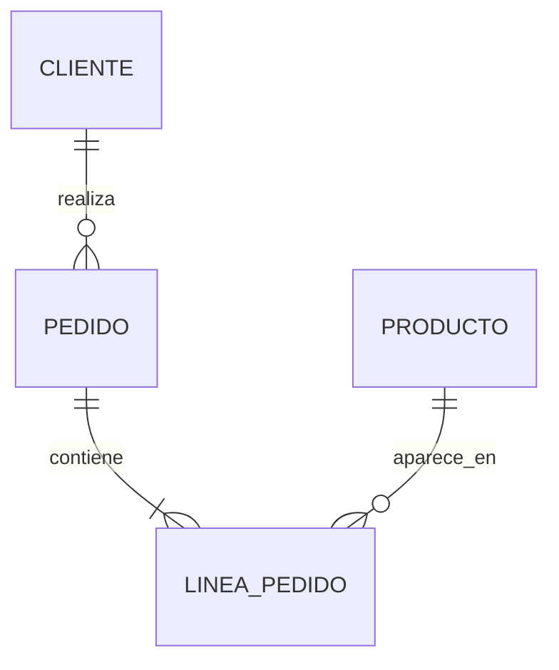
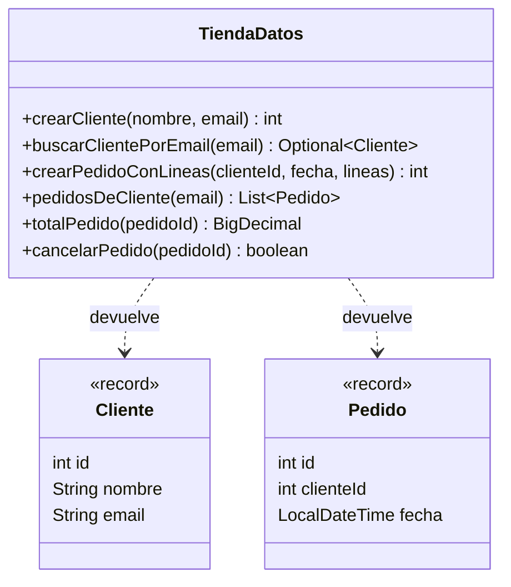
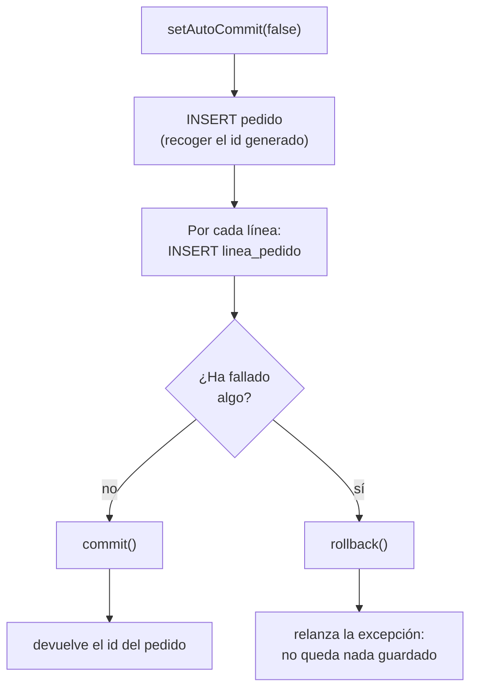

# ej04 · Cierre de la unidad: los pedidos de la tienda

**Unidad:** UT2 · **CE que evidencia:** a, b, c, e, f (parte de datos), g · **Sesión:** 4 · **Tiempo:** núcleo ~1 h 15 min en clase + complemento y escrito ~1 h 15 min en casa · **Antes:** haber hecho ej01, ej02 y ej03 y leído los apuntes [09](../../apuntes/09-preparedstatement-e-inyeccion.md) y [10](../../apuntes/10-transacciones-en-jdbc.md)

## Tu misión

La tienda ya tiene productos. Hoy le das lo que le faltaba desde el principio de la unidad: **clientes que compran**. Vas a programar el acceso a datos de los **pedidos**, con una regla de oro: **un pedido nunca puede quedar a medias**.

Es el ejercicio que cierra la UT2. Reúne todo lo anterior: servidor, SQL, JDBC, consultas seguras… y añade una pieza nueva, la **transacción en JDBC**.



**Figura · Las clases del ejercicio.** `TiendaDatos` es la única con lógica; `Cliente` y `Pedido` son `record` que guardan filas.



## Antes de empezar

- [ ] Servidor MySQL en `healthy` y el esquema del [ej02](../ej02-sql-crud/00-esquema.sql) ya creado.
- [ ] Mismos pasos de entorno que el ej03 (`mvnw`, `.env` copiado de `.env.example` y cargado en la terminal: ver el paso 4 del [ej03](../ej03-crud-jdbc/README.md)). Para ejecutar `App` usa `./mvnw -q compile exec:java`.

## La pieza nueva: transacciones en JDBC

La explicación completa está en el [apunte 10](../../apuntes/10-transacciones-en-jdbc.md). Resumen: por defecto cada sentencia se confirma al instante (*auto-commit*). Para agrupar varias:

```java
try (Connection conexion = DriverManager.getConnection(url, usuario, clave)) {
    conexion.setAutoCommit(false);          // 1) abrimos la transacción
    try {
        // ... varias sentencias con PreparedStatement ...
        conexion.commit();                  // 2) todo bien: confirmar
    } catch (Exception e) {
        conexion.rollback();                // 3) algo falló: deshacer TODO
        throw e;
    }
}
```

Todas las sentencias de la transacción deben usar **la misma** `Connection`.

**Figura · El camino de `crearPedidoConLineas`.** O todo se confirma, o todo se deshace.



## Paso 1 · Predice

Lee los tests de [`TiendaDatosTest`](src/test/java/es/dwes/ut02/TiendaDatosTest.java) y apunta:

1. Si un pedido tiene 3 líneas y la tercera falla, ¿cuántas filas quedan en `pedido` y en `linea_pedido` **sin** transacción? ¿Y **con** ella?
2. ¿Por qué en `cancelarPedido` hay que borrar primero las líneas y luego el pedido?

Ejecuta `mvnw test` y comprueba cuántos fallan con el esqueleto.

## Paso 2 · Núcleo (en clase): clientes y la primera transacción

Resuelve en este orden los `TODO` de [`TiendaDatos`](src/main/java/es/dwes/ut02/TiendaDatos.java):

| TODO | Método | Idea |
|---|---|---|
| 1 | `crearCliente` | `INSERT` + clave generada. El email repetido lo rechaza la BD. |
| 2 | `buscarClientePorEmail` | `SELECT … WHERE email = ?` (¡con parámetro!). |
| 3 | `crearPedidoConLineas` | **La pieza nueva.** Una transacción: `INSERT` del pedido, luego un `INSERT` por línea. Si falla algo, `rollback`. |

Dos ayudas para el TODO 3:

- Las líneas llegan en un `Map<Integer, Integer>` (`idProducto → cantidad`). Se recorre con `for (Map.Entry<Integer, Integer> linea : lineas.entrySet())`, y `linea.getKey()` / `linea.getValue()` dan cada par.
- La fecha del pedido llega como `LocalDateTime`; JDBC la recibe con `ps.setTimestamp(2, Timestamp.valueOf(fecha))` y se lee con `rs.getTimestamp("fecha").toLocalDateTime()`.

Los tests `…NoDejaNada` comprueban lo importante: tras un fallo, la base de datos **queda exactamente como estaba**.

## Paso 3 · Complemento (en casa): consultas y cancelar

| TODO | Método | Idea |
|---|---|---|
| 4 | `pedidosDeCliente` | `JOIN` de `pedido` y `cliente` filtrando por email. |
| 5 | `totalPedido` | `SUM(cantidad * precio)` con `JOIN` a `producto`. El precio es el **actual** del producto (simplificación del ej02). |
| 6 | `cancelarPedido` | Otra transacción: borrar las líneas y después el pedido. |

## Paso 4 · Pruébalo contra MySQL

Antes, **reinicia el estado** si has hecho otros ejercicios: `docker compose down -v` y `docker compose up -d` en `mi-mysql`, y ejecuta `00-esquema.sql` del ej02 en DBeaver. Con las variables de entorno cargadas, ejecuta `App.java`.

**Deberías ver:** el cliente creado, un pedido con su total (`188.80`: 2 teclados y 1 monitor), la lista con ese pedido y, tras cancelarlo, la lista vacía. Mira en DBeaver que no quedan filas sueltas.

## Cómo comprobarlo

```bash
./mvnw test
```

**Deberías ver:** `Tests run: 14, Failures: 0, Errors: 0` y `BUILD SUCCESS`.

## Paso 5 · Cierre de la unidad (por escrito)

En un `ej04.md`, responde con tus palabras (3-5 líneas cada una):

1. ¿Qué diferencia hay entre una restricción de la BD (`CHECK`, `FOREIGN KEY`) y una validación en Java? ¿Por qué conviene tener las dos?
2. ¿Qué ataque evita `PreparedStatement` y qué no evita?
3. ¿Qué es una transacción y qué garantía ACID has comprobado con el test de «producto inexistente»?
4. Hoy abres una conexión en cada método. ¿Qué problema tiene y qué solución se te ocurre? *(Se retoma en la UT3 y la UT4.)*

<details>
<summary>Respuestas de referencia (compruébalas después de escribir las tuyas)</summary>

1. La BD protege siempre, venga el dato de donde venga (otra aplicación, DBeaver); la validación en Java da mejor mensaje al usuario y ahorra viajes a la BD. Se complementan.
2. Evita la inyección SQL en los **valores**. No protege nombres de columna o tabla (eso requiere lista blanca) ni sustituye a validar la entrada.
3. Un grupo de operaciones que se aplican todas o ninguna. El test comprueba la **atomicidad**.
4. Conectar es caro y cada método paga ese coste. Solución: reutilizar conexiones ya abiertas (*pool*) o pasar una conexión entre métodos.

</details>

## Reto opcional

Añade `eliminarCliente(int id)` que borre un cliente **y todos sus pedidos** con sus líneas, en una sola transacción. Escribe primero el test (en rojo).

> **Si te atascas:** [guía de transacciones](../../refuerzos/05-guia-transacciones.md) · [ejemplo C paso a paso](../../refuerzos/09-ejemplos-trabajados.md#ejemplo-c-dos-updates-que-ocurren-los-dos-o-ninguno) · [leer los tests y depurar](../../refuerzos/08-leer-tests-y-depurar.md) · [chuleta de JDBC](../../refuerzos/04-chuleta-jdbc.md).

## Entrega

Sube la carpeta del ejercicio (sin `target/` ni `.env`) y tu `ej04.md` en una rama `feat/ut02-ej04` y abre un pull request.
