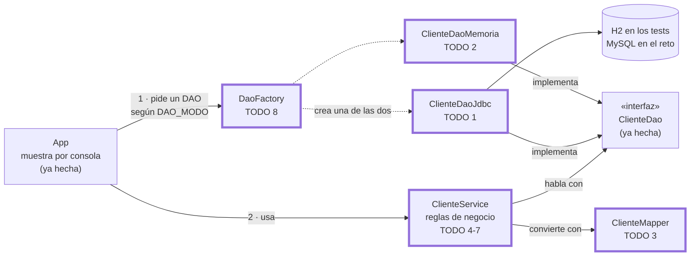
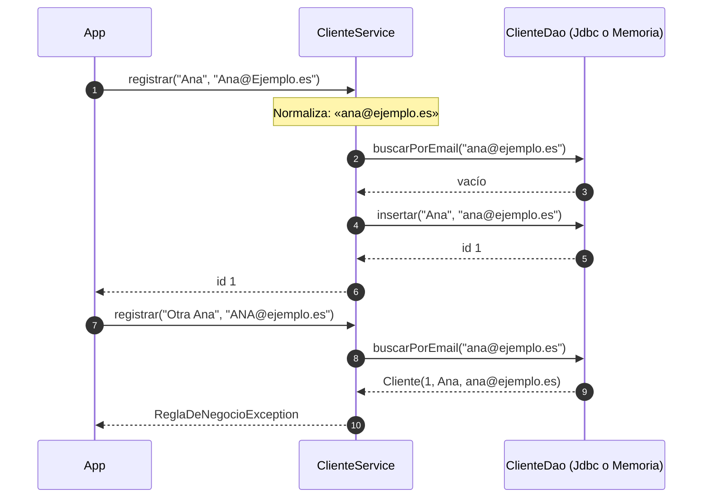
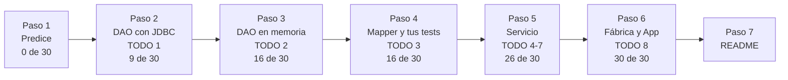
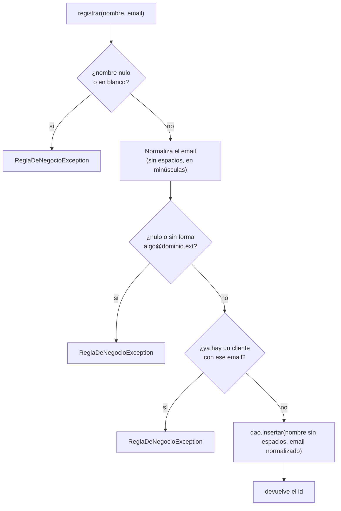
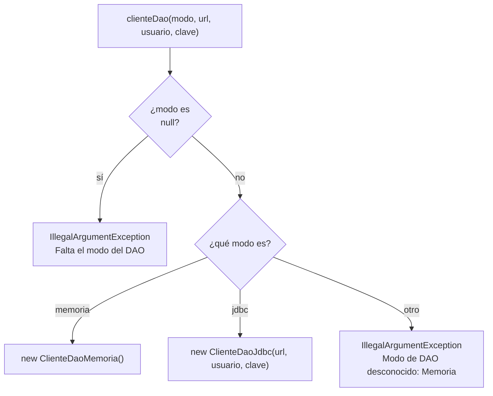

# ej06 · Práctica evaluable: los clientes de la tienda

**Unidad:** UT3 · **CE que evidencia:** a, b, g, h (criterios de evaluación; están en la [tabla de la unidad](../../README.md#ra-y-criterios-de-evaluación)) · **Tiempo:** 3 h 40 min en total, en casa (orientativo, ver «La ruta, de un vistazo») · **Apuntes previos:** [01](../../apuntes/01-refactorizacion-y-patrones.md), [02](../../apuntes/02-dao-y-dto.md), [03](../../apuntes/03-fabrica-y-servicio.md) y [04](../../apuntes/04-mvc-pruebas-y-documentacion.md) · **Modelo a seguir:** tu [ej05](../ej05-tienda-por-capas/README.md) · **Ayuda:** [centro de ayuda de la UT3](../../refuerzos/README.md)

> **Cómo se usa este README.** Si una palabra no te suena, búscala en el desplegable «Palabras que vas a necesitar» (más abajo, antes de «Antes de empezar»). Es un paso a paso: hazlo **en orden, de arriba abajo**. Cada paso te dice qué vas a conseguir, qué fichero abrir, qué comando ejecutar y **qué deberías ver**. Si lo que ves no coincide, mira «Si algo falla» de ese paso antes de seguir. Cada `TODO` tiene **dos niveles de ayuda**: (1) lo que tienes que hacer, a la vista, y (2) un bloque plegado «Si te atascas» con las herramientas que vas a usar. Los *commits* (guardados de tu trabajo en Git) de cada paso **sí cuentan** en esta práctica (indicador C5 de la lista de cotejo, más abajo).

> [!IMPORTANT]
> Esta práctica **se evalúa** (rúbrica y lista de cotejo, más abajo). Es **individual**. Puedes consultar tus apuntes y el ej05, pero el código y el README los escribes tú. Por eso este README te dice **qué hacer y qué herramientas usar**, pero no trae «casi la solución» como el del ej05.

## Tu misión

Ya has separado en capas la tienda de **productos**. Ahora te toca hacerlo tú, **sin el paso a paso del ej05**, con los **clientes**: aplica exactamente el mismo patrón, **DAO, mapper y DTO, servicio, fábrica y tests**, y documenta el resultado en un README.

Te damos un proyecto con **30 pruebas automáticas** (*tests*: programas que comprueban que tu código hace lo esperado) y las piezas a medias. Tu trabajo: escribir lo que falta, **un `TODO` cada vez**, hasta que las 30 salgan en verde; **escribir tus propios tests** (el mapper no trae ninguno dado); y entregar un **README** del proyecto.

**Figura 1 · Las piezas de la práctica y quién usa a quién.** Línea continua = «usa» o «implementa»; línea punteada = «crea». Los recuadros con borde grueso son los que escribes tú.



Lo importante de la figura: **`ClienteService` solo conoce la interfaz `ClienteDao`**. Y **solo `DaoFactory` nombra las clases concretas**. Es lo mismo que en el ej05, con otra entidad.

**Figura 2 · Qué ocurre cuando `App` registra a un cliente.** Sigue los números de arriba abajo; la segunda llamada es la regla del email repetido.



### Qué escribes y qué ya está hecho

| Pieza | ¿La escribes tú? | Para qué sirve |
|---|---|---|
| `Cliente`, `ClienteDto` | No (ya hechas) | Una fila de la tabla y lo que se enseña en pantalla |
| `ClienteDao` | No (ya hecha) | La lista de cosas que se pueden hacer con los clientes (la «interfaz») |
| `AccesoDatosException`, `ReglaDeNegocioException` | No (ya hechas) | Los dos tipos de error |
| `App` | No (ya hecha) | El programa que lo muestra todo por consola |
| `ClienteDaoJdbc` | **Sí · TODO 1** | Guarda y lee clientes con JDBC |
| `ClienteDaoMemoria` | **Sí · TODO 2** | Lo mismo, en memoria |
| `ClienteMapper` | **Sí · TODO 3** | Convierte `Cliente` en `ClienteDto` y **oculta el email** |
| `ClienteService` | **Sí · TODO 4 a 7** | Las reglas de negocio |
| `DaoFactory` | **Sí · TODO 8** | Decide qué DAO se usa |
| `ClienteMapperTest` | **Sí** (mínimo 3 tests) | Tu comprobación del mapper |
| `README.md` del proyecto | **Sí** | Documenta lo que has hecho |

Todas las clases están en `src/main/java/es/dwes/ut03/`; los tests, en `src/test/java/es/dwes/ut03/`.

### Reglas de negocio (están en el Javadoc de `ClienteService`)

- Nombre no vacío; se guarda sin espacios sobrantes.
- Email con forma `algo@dominio.ext` (sin espacios, una sola arroba, un punto en el dominio); se guarda **en minúsculas y sin espacios**.
  Válidos: `a@x.es`, `juan@mail.empresa.com`. No válidos: `sinarroba.es`, `a@@x.es`, `a@.es` (nada antes del punto), `a@x` (sin punto en el dominio) y `a b@x.es` (con espacio).
- No puede haber dos clientes con el mismo email aunque cambien las mayúsculas.
- Incumplir una regla lanza `ReglaDeNegocioException` y no guarda nada.

### Por qué el DTO oculta el email

`ClienteDto` muestra `a***@ejemplo.es`, no `ana@ejemplo.es`. Es **minimización de datos**: la pantalla no necesita el dato completo, así que no se lo damos. Además, no lleva el `id`.

<details>
<summary><strong>Palabras que vas a necesitar</strong> (ábrelo antes del paso 2 y vuelve cuando una palabra no te suene)</summary>

**Repaso: lo que ya deberías saber** (Java de 1.º, UT1-UT2, ej05 y lo básico de Git: `git add` y `git commit`, que ya usaste en el ejercicio 00).

| Palabra | Qué significa, en una frase |
|---|---|
| **Test** | Código que llama a tu código y comprueba el resultado. **Verde** = pasa; **rojo** = falla. |
| **`record`** | Clase de solo datos e inmutable: `new Cliente(1, "Ana", "ana@ejemplo.es")` y se lee con `c.nombre()`. |
| **`Optional`** | Una «caja» que contiene un valor o está vacía, para no devolver `null`. |
| **`Map` / `TreeMap`** | Pares clave → valor; con el `id` obtienes el cliente. `TreeMap` mantiene las claves ordenadas. |
| **`try-with-resources`** | Un `try (...)` que **cierra solo** la conexión y las consultas al terminar. |
| **Expresión regular** | Un patrón de texto que describe qué forma debe tener una cadena. En Java, `Pattern.compile(patron).matcher(texto).matches()` dice si **todo** el texto encaja. Piezas que necesitas: `[^@\s]+` (uno o más caracteres que no son arroba ni espacio), `@` y `\.` (un punto de verdad), `+` (una o más veces) y `( … )+` (un grupo que se repite). |
| **Parámetro `?`** | El hueco de una consulta SQL que rellenas con un valor; evita la inyección SQL. |
| **H2** | Una base de datos pequeña en memoria; solo se usa en los tests. |
| **Variable de entorno** | Un ajuste con nombre (aquí, `DAO_MODO`) que el sistema entrega al programa. |

**Palabras de esta práctica.** Se explican en los [apuntes 02 a 04](../../apuntes/03-fabrica-y-servicio.md) y en el [glosario de la UT3](../../../../recursos/glosario.md#ut3--patrones-de-diseño-en-el-desarrollo-web).

| Palabra | Qué significa, en una frase |
|---|---|
| **DAO / DTO / mapper / servicio / fábrica** | Las cinco piezas del ej05: guardar y leer, datos para mostrar, convertir, reglas, y elegir implementación. |
| **Test de contrato** | El mismo test ejecutado contra varias implementaciones del DAO para demostrar que se comportan igual. |
| **Caso límite** | Un dato justo en el borde de lo válido (por ejemplo, una parte local de **una sola letra**: `a@x.es`). |
| **Commit** | Un guardado de tu trabajo en Git, con un mensaje que dice qué has hecho. |
| **Javadoc** | Comentario especial `/** … */` que documenta una clase o un método. |
| **Minimización de datos** | Dar solo los datos que hacen falta. |

</details>

## Antes de empezar

Haz estas comprobaciones **una sola vez**. Si alguna no sale como se indica, resuélvela ahora y no sigas.

### A · Descarga y descomprime

1. Descarga [ejercicios-ut03.zip](../../../../descargas/ejercicios-ut03.zip) y descomprímelo **fuera** de la carpeta `materialClase`.
2. Abre una terminal **dentro de la carpeta `ej06-practica-clientes`** (la que contiene `pom.xml`). En VS Code: *Archivo → Abrir carpeta* y después *Terminal → Nueva terminal*.
3. Comprueba que estás en el sitio correcto:

```bash
ls
```

```powershell
dir
```

**Deberías ver**, entre otros: `README.md`, `pom.xml`, `src`, `reto`, `docker-compose.yml`, `bd`, `mvnw` y `mvnw.cmd`.

### B · Comprueba Java y Maven

```bash
java -version
javac -version
./mvnw -v
```

**Deberías ver** una versión **21** (o superior) en `java` y en `javac`, la **misma** en las dos, y una línea `Apache Maven 3.` Si falla, repasa la [guía del JDK](../../../../docs/entorno/README.md#instalar-el-jdk-21); si tienes a mano la carpeta `materialClase` del curso, su comprobador hace estas mismas pruebas (`bash recursos/verificar-entorno/verificar-entorno.sh`, ejecutado desde esa carpeta); si no, bastan los tres comandos de arriba.

> **Windows (PowerShell):** en todos los comandos de este README, cambia `./mvnw` por `.\mvnw.cmd`. En Linux y macOS usa `./mvnw` tal cual; si ves `Permission denied`, ejecuta `chmod +x mvnw`.

### C · Git

```bash
git init
```

`git init` convierte la carpeta actual en un **repositorio**: crea una carpeta oculta, `.git`, donde Git guarda el historial de tus commits. Se evalúa que hagas **un commit por paso** (indicador C5), así que créalo ahora. Si Git te pide quién eres: `git config --global user.name "Tu Nombre"` y `git config --global user.email "tu-correo@ejemplo.com"`.

### D · Docker (opcional)

**No hace falta Docker ni MySQL** para la práctica: los tests del DAO JDBC usan una base H2 en memoria y `App` funciona en modo memoria. Docker solo se usa en el [reto 1](#retos-opcionales).

## La ruta, de un vistazo

**Figura 3 · El camino completo y cuántos de los 30 tests dados deberías tener en verde al terminar cada parte.** Los números están comprobados con la solución de referencia.



| Paso | Qué haces | Tiempo orientativo |
|---|---|---|
| Preparación y 1 · Predice | Comprobaciones A a C y primera ejecución | 10 min |
| 2 · `ClienteDaoJdbc` | TODO 1 | 40 min |
| 3 · `ClienteDaoMemoria` | TODO 2 | 20 min |
| 4 · `ClienteMapper` y tus 3 tests | TODO 3 | 40 min |
| 5 · `ClienteService` | TODO 4-7 | 40 min |
| 5b · Javadoc y tests propios del servicio | Los 4 tests del paso 5 y el Javadoc de tus métodos públicos | 25 min |
| 6a · `DaoFactory` | TODO 8 | 15 min |
| 6b · Ejecutar `App` | Sin base de datos | 10 min |
| 7 · README del proyecto | Documentar | 20 min |
| **Total** | | **3 h 40 min** |

Es una estimación, calculada a partir de lo que cuesta el mismo trabajo en el [ej05](../ej05-tienda-por-capas/README.md) (aquí hay menos métodos, pero ya sin la ayuda «casi la solución»). Si es tu primer DAO sin pistas, cuenta hasta **4 h 30 min** (el email del servicio es lo que más se alarga) y algo más si `Map` y `Optional` te son nuevos. La primera vez que ejecutes Maven tardará unos minutos más, porque descarga las dependencias.

---

## Paso 1 · Predice (5 min)

**Qué vas a conseguir:** ver el punto de partida y leer tu primer mensaje de test.

1. **Antes de ejecutar nada, apunta en un papel** cuántos de los 30 tests crees que pasan ahora mismo.
2. Ejecuta los tests **sin tocar nada**:

```bash
./mvnw test
```

3. Mira el final de la salida. **Deberías ver:**

```text
[ERROR] Tests run: 30, Failures: 4, Errors: 26, Skipped: 0
[INFO] BUILD FAILURE
```

No pasa ninguno: es lo esperado. Busca más arriba una línea como esta:

```text
[ERROR]   ClienteDaoJdbcTest>ClienteDaoContratoTest.buscarPorEmailDevuelveVacioSiNoExiste:45 » UnsupportedOperation TODO 1
```

El número que va tras el nombre del test (`:45`) es la línea del fichero de tests donde falló; los números de línea de los mensajes de este README pueden variar con tu código.

Se lee así: «el test `buscarPorEmailDevuelveVacioSiNoExiste` falló con `UnsupportedOperation TODO 1`». Es el esqueleto avisándote de que **ese método todavía no está escrito**. No es un error tuyo: es tu lista de tareas. Para ver todos los pendientes de golpe, en VS Code pulsa `Ctrl+Shift+F` y busca `TODO`.

> **Fallo y error.** Los 4 *fallos* (`Failures`) son tests que esperan una excepción concreta y reciben otra (`UnsupportedOperationException`, la excepción de Java que significa «esto aún no está hecho»); los 26 *errores* (`Errors`) son ese mismo aviso, lanzado por cada `TODO`. Para ti son lo mismo: ese test aún no pasa.

> **Verás muchas veces `TODO 2`.** Los tests del servicio preparan sus datos con el DAO en memoria. Mientras no hagas el TODO 2, fallan **todos** con ese mensaje: es una sola pieza la que los bloquea.

**Guarda tu progreso:** `git add .; git commit -m "chore: esqueleto de la práctica"`.

---

## Paso 2 · `ClienteDaoJdbc` (TODO 1) — 40 min

**Qué vas a conseguir:** que `ClienteDaoJdbc` lea y escriba clientes en una base de datos. Es el mismo trabajo que `ProductoDaoJdbc` del ej05, con una tabla de tres columnas.

**Tests que lo vigilan:** `ClienteDaoJdbcTest` (9). Al terminar tendrás **9 de 30** en verde.

### Qué tienes que hacer

Abre `src/main/java/es/dwes/ut03/ClienteDaoJdbc.java`. Escribe, en este orden:

1. Un método `conectar()` y un método auxiliar que convierta una fila en `Cliente` (los dos son privados y los usan los demás).
2. `listar()`: todos los clientes, **ordenados por id**.
3. `buscarPorEmail(email)`: `Optional.of(...)` si hay fila y `Optional.empty()` si no.
4. `insertar(nombre, email)`: devuelve el **id** que genera la base.
5. `eliminar(id)`: `true` si la fila existía, `false` si no.

Las reglas son las del ej05 ([paso 2.2](../ej05-tienda-por-capas/README.md#22--tres-reglas-que-cambian-respecto-al-ej03) y [receta](../ej05-tienda-por-capas/README.md#23--la-receta-sirve-para-los-seis-métodos)):

- **Ningún método declara `throws SQLException`.** La envuelves en `AccesoDatosException`, **pasando la original como causa**.
- **Parámetros `?`**, nunca texto pegado con `+` (hay un test de inyección SQL).
- **`try-with-resources`** para cerrar conexión, consulta y resultado.

### La tabla que usa el DAO

Una tabla `cliente` de tres columnas: `id` (número que se genera solo), `nombre` y `email` (la base **no deja repetirlo**: tiene una restricción `UNIQUE` (que impide valores repetidos en esa columna)). La crea el test (míralo en `ClienteDaoJdbcTest`); tú no tienes que crearla.

<details>
<summary><strong>Si te atascas</strong> · qué vas a usar en el TODO 1</summary>

| Método | Qué vas a usar |
|---|---|
| `conectar()` y la conversión | `DriverManager.getConnection(url, usuario, clave)` y `new Cliente(rs.getInt("id"), rs.getString("nombre"), rs.getString("email"))` |
| `listar` | `SELECT … ORDER BY id`, `executeQuery()`, un bucle `while (rs.next())` y una `ArrayList` |
| `buscarPorEmail` | `WHERE email = ?`, `ps.setString(1, email)`, `rs.next()` |
| `insertar` | `INSERT … VALUES (?, ?)`, `prepareStatement(sql, Statement.RETURN_GENERATED_KEYS)`, `executeUpdate()` y `getGeneratedKeys()` |
| `eliminar` | `DELETE … WHERE id = ?` y el número que devuelve `executeUpdate()` |

Un email repetido hace que la base lance una `SQLException`: no hace falta que la detectes aparte, basta con envolverla.

</details>

### Punto de control

Ve método a método. Cada filtro ejecuta solo los tests de ese método:

| Terminas | Comando | Deberías ver |
|---|---|---|
| `listar` | `./mvnw test -Dtest='ClienteDaoJdbcTest#listar*'` | `Tests run: 1`, sin fallos |
| `buscarPorEmail` | `./mvnw test -Dtest='ClienteDaoJdbcTest#buscarPorEmail*'` | `Tests run: 3`, sin fallos |
| `insertar` | `./mvnw test -Dtest='ClienteDaoJdbcTest#insertar*'` | `Tests run: 2`, sin fallos |
| `eliminar` | `./mvnw test -Dtest='ClienteDaoJdbcTest#eliminar*'` | `Tests run: 2`, sin fallos |

Algún test usa más de un método para preparar o comprobar (por ejemplo, el de `eliminar` mira el resultado con `buscarPorEmail`), así que si uno no se pone en verde, mira si te falta otro método. Cuando termines los cuatro (el noveno test, el de la base no disponible, se pone en verde con cualquiera de ellos bien envuelto):

```bash
./mvnw test -Dtest=ClienteDaoJdbcTest
```

**Deberías ver:** `Tests run: 9, Failures: 0, Errors: 0`.

### Si algo falla

| Mensaje (real) | Qué significa | Qué hacer |
|---|---|---|
| `insertarDevuelveElIdNuevoYElClienteQuedaGuardado:50 » AccesoDatos No se pudo insertar el cliente` | Falta pedir las claves generadas: `prepareStatement(sql)` sin `Statement.RETURN_GENERATED_KEYS` | Pásalo como segundo argumento de `prepareStatement` |
| `buscarPorEmail… » AccesoDatos No se pudo buscar el cliente por email` en 5 tests | No has rellenado el `?` (falta `ps.setString(1, email)`) | Rellena el parámetro **antes** de `executeQuery()` |
| `insertarUnEmailRepetidoLanzaAccesoDatosException:59 Unexpected exception type thrown, expected: <AccesoDatosException> but was: <UnsupportedOperationException>` | Aún no has escrito `insertar` | Hazlo; la base rechaza el email repetido y tú envuelves la excepción |
| `Cannot resolve symbol 'PreparedStatement'` o subrayado rojo en un nombre | Falta un `import` (la línea que dice de dónde viene una clase) | `Ctrl+.` y *Import*, o escríbelo tú |

**Guarda tu progreso:** `git add .; git commit -m "feat: ClienteDaoJdbc (TODO 1)"`.

---

## Paso 3 · `ClienteDaoMemoria` (TODO 2) — 20 min

**Qué vas a conseguir:** la misma interfaz, pero guardando en memoria, para que el servicio se pueda probar sin base de datos.

**Tests que lo vigilan:** `ClienteDaoMemoriaTest` (7), el mismo contrato que el DAO JDBC. Al terminar tendrás **16 de 30**.

### Qué tienes que hacer

Abre `ClienteDaoMemoria.java`. Elige la estructura de datos (por ejemplo, un `TreeMap<Integer, Cliente>`) y un contador de ids, y escribe los cuatro métodos. Tres detalles que miran los tests:

- Los **ids empiezan en 1** y **no se reutilizan**.
- `listar` devuelve los clientes **ordenados por id** y una **copia** (si el que llama cambia la lista, no cambia tu estructura).
- Como en la base (`email UNIQUE`), **insertar un email que ya existe lanza `AccesoDatosException`**. Su constructor pide un mensaje y una causa; en memoria no hay causa (no ha fallado ninguna `SQLException`), así que pasa `null`: `new AccesoDatosException("tu mensaje", null)`.

<details>
<summary><strong>Si te atascas</strong> · qué vas a usar en el TODO 2</summary>

| Método | Qué vas a usar |
|---|---|
| Estructura | `Map<Integer, Cliente>` (un `TreeMap`) y un `int siguienteId = 1` |
| `listar` | `new ArrayList<>(clientes.values())` |
| `buscarPorEmail` | recorrer `clientes.values()` con un `stream` (un recorrido de la colección con pasos encadenados) y `filter(…).findFirst()` (se queda con el primero que cumple la condición y devuelve ya un `Optional`) |
| `insertar` | comprobar con tu propio `buscarPorEmail`, `siguienteId++` y `clientes.put(id, …)` |
| `eliminar` | `clientes.remove(id) != null` |

</details>

### Punto de control

```bash
./mvnw test -Dtest=ClienteDaoMemoriaTest
```

**Deberías ver:** `Tests run: 7, Failures: 0, Errors: 0`. Con `./mvnw test` tendrás 16 en verde (los otros 14 son del servicio y de la fábrica).

### Si algo falla

| Mensaje (real) | Qué significa | Qué hacer |
|---|---|---|
| `insertarUnEmailRepetidoLanzaAccesoDatosException:59 Expected es.dwes.ut03.AccesoDatosException to be thrown, but nothing was thrown.` | No compruebas el email repetido al insertar | Busca el email antes de guardar y lanza `AccesoDatosException` |
| `buscarPorEmailEncuentraAlClienteSiExiste:39 expected: <2> but was: <1>` (y otros dos tests) | El contador de ids empieza en 0, no en 1 | `int siguienteId = 1` |
| `ClienteDaoMemoriaTest>…preparar:23->crearDaoConDosClientes:9 » UnsupportedOperation TODO 2` | Aún no has escrito `insertar` | Hazlo: el test lo usa para preparar sus datos |

**Guarda tu progreso:** `git add .; git commit -m "feat: ClienteDaoMemoria (TODO 2)"`.

---

## Paso 4 · `ClienteMapper` y tus tests (TODO 3) — 30 min

**Qué vas a conseguir:** el mapper que convierte un `Cliente` en un `ClienteDto` **ocultando el email**, y los primeros tests que escribes tú.

**Tests que lo vigilan:** ninguno dado. Los escribes tú en `ClienteMapperTest`, mínimo **3**.

### Qué tienes que hacer

1. Abre `ClienteMapper.java`. `aDto(cliente)` devuelve un `ClienteDto` con el nombre copiado y el email oculto: primera letra de la parte local, `***` y el dominio completo. `ana@ejemplo.es` pasa a `a***@ejemplo.es`. El mapper puede suponer que el email ya es válido: el servicio lo valida.
2. Abre `ClienteMapperTest.java` (está vacío) y escribe **al menos 3 tests**: un caso normal, una parte local de **una sola letra** (`a@x.es`) y que el nombre se copia sin cambios. Piensa también en subdominios (`juan@mail.empresa.com`).
3. Mira cómo está hecho `ProductoMapperTest` en el ej05 para la estructura: crear el objeto, llamar al mapper y comparar con `assertEquals(esperado, obtenido)`.

Puedes escribir los tests **antes** que el mapper y verlos pasar de rojo a verde.

<details>
<summary><strong>Si te atascas</strong> · qué vas a usar en el TODO 3</summary>

| Qué | Qué vas a usar |
|---|---|
| Buscar la arroba | `email.indexOf('@')` |
| Primera letra | `email.charAt(0)` |
| El dominio, con la arroba | `email.substring(posicionDeLaArroba)` |
| Un test | `@Test`, `assertEquals(esperado, ClienteMapper.aDto(...).emailOculto())` |

</details>

### Comprueba que tus tests sirven

Un test que nunca falla no demuestra nada. Con el mapper terminado y tus tests en verde, **róMpelo a propósito**: en la línea donde pones la primera letra, cambia `email.charAt(0)` por `email.substring(0, 2)` y vuelve a ejecutar. **Deberías ver** que tus tests fallan con mensajes como estos:

```text
ClienteMapperTest.…:24 expected: <a***@x.es> but was: <a@***@x.es>
ClienteMapperTest.…:14 expected: <a***@ejemplo.es> but was: <an***@ejemplo.es>
```

Si tus tests siguen en verde con el mapper roto, no vigilan lo que creías: añade el caso que falta. Después **deja el mapper bien otra vez**.

### Punto de control

```bash
./mvnw test -Dtest=ClienteMapperTest
```

**Deberías ver:** `Tests run:` **3 o más** y sin fallos (con `Tests run: 0` todavía no has escrito tests). Los 16 en verde de los 30 dados no cambian: el mapper no tiene tests dados.

### Si algo falla

| Mensaje (real) | Qué significa | Qué hacer |
|---|---|---|
| `Tests run: 0` | `ClienteMapperTest` está vacío o los métodos no llevan `@Test` | Escribe tests con `@Test` encima y los `import` de JUnit |
| `expected: <a***@x.es> but was: <a@***@x.es>` | Con una parte local de una letra, tu código corta mal | Usa solo la primera letra y la posición de la arroba |
| `UnsupportedOperationException: TODO 3` en un test del servicio | Falta el mapper | Haz este paso antes de seguir |

**Guarda tu progreso:** `git add .; git commit -m "feat: ClienteMapper y sus tests (TODO 3)"`.

---

## Paso 5 · `ClienteService` (TODO 4 a 7) — 40 min

**Qué vas a conseguir:** las reglas de negocio. `ClienteService` recibe un `ClienteDao` en el constructor (ya hecho) y lo usa **sin saber cuál es**: por eso `ClienteServiceTest` le pasa un DAO en memoria y no necesita base de datos.

**Tests que lo vigilan:** `ClienteServiceTest` (10). Al terminar tendrás **26 de 30**.

Las reglas están escritas en el Javadoc de cada método de `ClienteService.java`: léelas ahí primero y, si dudas, en `ClienteServiceTest`.

| TODO | Método | Qué hace |
|---|---|---|
| 4 | `registrar(nombre, email)` | Valida, normaliza, rechaza duplicados y guarda. **El más largo** |
| 5 | `listar()` | Todos los clientes como `ClienteDto` |
| 6 | `buscarPorEmail(email)` | Un cliente como DTO; `ReglaDeNegocioException` si no existe |
| 7 | `darDeBaja(email)` | Borra al cliente; `ReglaDeNegocioException` si no existe |

<details>
<summary><strong>Comprueba tu diseño</strong> · ábrelo cuando hayas intentado el TODO 4</summary>

**Figura 4 · En qué orden decide `registrar`.** Cada rombo es una regla; cualquier «no» lanza `ReglaDeNegocioException` y **no guarda nada**.



</details>

<details>
<summary><strong>Si te atascas</strong> · qué vas a usar en los TODO 4 a 7</summary>

| TODO | Qué vas a usar |
|---|---|
| 4 | `nombre == null \|\| nombre.isBlank()`, `strip()`, `toLowerCase` con `Locale.ROOT` (un idioma «neutro»: así el resultado es el mismo en cualquier equipo), una expresión regular (`Pattern.compile(…).matcher(email).matches()`), `dao.buscarPorEmail(…).isPresent()` y `dao.insertar(…)` |
| 5 | `dao.listar().stream().map(ClienteMapper::aDto).toList()` |
| 6 | el mismo normalizado que en el 4, `dao.buscarPorEmail(…).map(ClienteMapper::aDto).orElseThrow(() -> new ReglaDeNegocioException(…))` |
| 7 | `buscarPorEmail` + `orElseThrow` (como en el 6) y `dao.eliminar(cliente.id())` |

**Normalizar el email son tres cosas, en este orden:** comprobar que no es `null`, quitar espacios y pasar a minúsculas. Hazlo en un método auxiliar privado: lo usan los tres TODO.

**La forma del email** se comprueba con una expresión regular. Construye el patrón por trozos: «uno o más caracteres que no son arroba ni espacio», una `@`, «uno o más caracteres que no son arroba, espacio ni punto» y, una o más veces, un punto seguido de más caracteres de ese tipo. Pruébalo con los ejemplos válidos y no válidos de las reglas de negocio: tu test `registrarRechazaEmailsInvalidos` (el de los tests dados) mira varios.

</details>

### Punto de control

Por métodos: `-Dtest='ClienteServiceTest#registrar*'` (`Tests run: 5`), `#listar*` (1), `#buscar*` (2) y `#darDeBaja*` (2). Cuando termines los cuatro TODO:

```bash
./mvnw test -Dtest=ClienteServiceTest
```

**Deberías ver:** `Tests run: 10, Failures: 0, Errors: 0`. Con `./mvnw test` tendrás **26 en verde y 4 en rojo** (los 4 de la fábrica).

### Si algo falla

| Mensaje (real) | Qué significa | Qué hacer |
|---|---|---|
| `registrarRechazaNombresNulosOEnBlanco:40 Unexpected exception type thrown, expected: <ReglaDeNegocioException> but was: <NullPointerException>` | Usas `nombre.isBlank()` sin comprobar antes `nombre == null` | Valida primero que no sea `null` |
| `registrarNormalizaElNombreYElEmail:34 » NoSuchElement No value present` | Guardas el email sin pasarlo a minúsculas | Guarda el email **normalizado**, no el que llegó |
| `registrarRechazaUnEmailYaRegistradoAunqueCambienLasMayusculas:57 Expected es.dwes.ut03.ReglaDeNegocioException to be thrown, but nothing was thrown.` | Buscas el duplicado con el email sin normalizar | Normaliza **antes** de buscar |
| `buscarPorEmailNormalizaLaBusqueda:72 » ReglaDeNegocio No existe un cliente con ese email` | `buscarPorEmail` (o `darDeBaja`) no normaliza el email que recibe | Normalízalo igual que al registrar |
| `UnsupportedOperationException: TODO 2` o `TODO 3` | El servicio usa el DAO en memoria o el mapper y aún no los has hecho | Haz primero el paso 3 y el 4 |

### Tests propios que merece la pena escribir

Los 30 tests dados no vigilan todo. Además de los 3 del mapper, escribe estos en `ClienteServiceTest` (o en una clase nueva) y verás errores que de otro modo pasarían desapercibidos:

- `registrar` con `sinarroba.es` (tiene punto, pero no arroba) debe lanzar `ReglaDeNegocioException`.
- `darDeBaja(" Ana@EJEMPLO.es ")` debe borrar a Ana (normaliza el email).
- Con dos clientes, dar de baja al segundo deja al primero.
- Con la base no disponible, `buscarPorEmail` y `eliminar` del DAO JDBC deben lanzar también `AccesoDatosException` (en `ClienteDaoJdbcTest`, copiando el patrón del test de `listar`).

Estos cuatro tests no son obligatorios para la lista de cotejo (C1 pide 3 tests propios, los del mapper), pero cuentan en el criterio «Pruebas» de la rúbrica (añadir pruebas propias y casos límite). Cada uno debe **pasar en verde** y hacer que el `Tests run:` de su clase suba en 1. Para comprobar que un test sirve, rompe a propósito la regla que vigila (como en el paso 4) y mira que falle.

**Guarda tu progreso:** `git add .; git commit -m "feat: ClienteService (TODO 4-7)"`.

---

## Paso 6 · Fábrica y `App` (TODO 8) — 25 min

### 6a · La fábrica: `DaoFactory` (TODO 8) — 15 min

**Qué vas a conseguir:** que `App` pida un DAO sin saber cuál recibe. La fábrica lee el **modo** (`"memoria"` o `"jdbc"`) y crea el DAO correspondiente. Es **el único sitio** de la práctica que nombra `ClienteDaoJdbc` y `ClienteDaoMemoria`.

**Tests que lo vigilan:** `DaoFactoryTest` (4). Al terminar tendrás **30 de 30**.

- El modo se escribe en **minúsculas**: `"Memoria"` es un modo desconocido.
- El mensaje del error por modo desconocido **debe nombrar el modo** que llegó (un test lo comprueba).
- Hay un test para el caso en que el modo es `null`: piensa qué haría un `switch` sobre un texto que vale `null`.
- Tienes un ejemplo de fábrica en el [apunte 03](../../apuntes/03-fabrica-y-servicio.md) y la tuya del [ej05](../ej05-tienda-por-capas/README.md#50--la-fábrica-daofactory-todo-9--10-min).

<details>
<summary><strong>Comprueba tu diseño</strong> · ábrelo cuando hayas intentado este TODO</summary>

**Figura 5 · Qué decide `DaoFactory.clienteDao(modo, …)`.**



</details>

<details>
<summary><strong>Si te atascas</strong> · qué vas a usar en el TODO 8</summary>

| TODO | Qué vas a usar |
|---|---|
| 8 | un `switch` sobre el texto del modo, `new ClienteDaoMemoria()`, `new ClienteDaoJdbc(url, usuario, clave)` e `IllegalArgumentException` |

</details>

```bash
./mvnw test -Dtest=DaoFactoryTest
```

**Deberías ver:** `Tests run: 4, Failures: 0, Errors: 0`.

| Mensaje (real) | Qué significa | Qué hacer |
|---|---|---|
| `unModoNuloTambienSeRechazaConIllegalArgumentException:35 Unexpected exception type thrown, expected: <IllegalArgumentException> but was: <NullPointerException>` | El `switch` recibe `null` y Java lanza `NullPointerException` | Comprueba `modo == null` **antes** del `switch` |
| `unModoDesconocidoSeRechazaConUnMensajeQueLoNombra:30 El mensaje debe decir qué modo no se conoce ==> expected: <true> but was: <false>` | El mensaje no contiene el modo que llegó | Añade el modo al texto: `"Modo de DAO desconocido: " + modo` |

### Punto de control: ¡todo en verde!

```bash
./mvnw test
```

**Deberías ver** `Tests run: 30 + los tuyos`, `Failures: 0, Errors: 0` y `BUILD SUCCESS`. Con tus 3 tests del mapper, serán 33.

**Guarda tu progreso:** `git add .; git commit -m "feat: DaoFactory (TODO 8)"`.

### 6b · Ejecútalo (10 min)

Hasta ahora solo has ejecutado tests. Ahora ejecutas el programa de verdad, `App`, **sin base de datos**.

> **Qué hace `./mvnw -q compile exec:java`.** `compile` compila el proyecto, `exec:java` ejecuta la clase `App` y `-q` (*quiet*) oculta los mensajes de Maven para que solo veas lo que escribe el programa. `App` lee la variable de entorno `DAO_MODO` (por defecto, `memoria`) para saber qué DAO pedir a la fábrica.

```bash
./mvnw -q compile exec:java
```

```powershell
.\mvnw.cmd -q compile exec:java
```

**Deberías ver** algo así (la última línea depende del mensaje que hayas escrito en tu `ReglaDeNegocioException`):

```text
Implementación del DAO: ClienteDaoMemoria
--- Clientes (email oculto) ---
Ana: a***@ejemplo.es
Luis: l***@ejemplo.es
Rechazado: Ya hay un cliente con ese email
```

Fíjate en que el mensaje **no repite el email**: es un dato personal y los mensajes de error acaban en pantallas y en registros. Pon en los tuyos lo mínimo para entender el fallo. En modo memoria, `App` registra a Ana (con el email `Ana@Ejemplo.es`, para que se vea la normalización) y a Luis, y al final intenta registrar otra vez `ANA@ejemplo.es`: tu regla de negocio lo rechaza. Prueba también un modo que no existe y mira el mensaje de tu fábrica:

```bash
DAO_MODO=mongo ./mvnw -q compile exec:java
```

```powershell
$env:DAO_MODO = "mongo"; .\mvnw.cmd -q compile exec:java
```

**Deberías ver** un error de Maven que termina con tu mensaje, por ejemplo `Modo de DAO desconocido: mongo`.

> **Solo PowerShell:** `$env:DAO_MODO` se queda fijado en esa terminal. Vuelve a `"memoria"` (o cierra la terminal) antes de seguir. Los comandos de PowerShell de este README no se han podido probar en Windows.

**Guarda tu progreso:** nada nuevo que guardar, `App` ya estaba hecha.

---

## Paso 7 · El README del proyecto — 20 min

**Qué vas a conseguir:** documentar lo que has construido para que otra persona lo entienda sin preguntarte. Escríbelo en un fichero llamado **`README-proyecto.md`** en la raíz de tu proyecto. Este fichero que estás leyendo es el enunciado, no el tuyo: no lo sobrescribas.

Usa estos apartados (los títulos son obligatorios; el contenido es tuyo):

```markdown
# Clientes de la tienda
## Qué es
## Estructura
## Cómo se ejecutan los tests y el programa
## Decisiones
```

Debe responder, en una página, a:

- **¿Qué es?** Una frase.
- **Estructura:** una tabla con cada clase, su capa y su trabajo.
- **Cómo se ejecutan los tests y el programa.**
- **Decisiones:** al menos dos, con su motivo (por ejemplo, por qué el DAO lanza `AccesoDatosException` y no `SQLException`, o por qué el servicio recibe la interfaz y no la clase).
- Un **diagrama Mermaid** con las capas (opcional, suma en la rúbrica). Mermaid es un diagrama escrito como texto dentro de un bloque ` ```mermaid `, como los de este mismo README.

Un ejemplo de qué es una buena decisión: «El servicio recibe `ClienteDao` por el constructor. Así los tests le pasan un DAO en memoria y no necesitan base de datos». Fíjate en que dice **qué** se decidió y **por qué**; una decisión sin motivo no cuenta.

**Guarda tu progreso:** `git add .; git commit -m "docs: README del proyecto"`.

---

## Qué tests vigilan qué

| Parte | TODO | Tests dados | En verde al acabar la parte |
|---|---|---|---|
| 2 · DAO JDBC | 1 | `ClienteDaoJdbcTest` (9) | 9 de 30 |
| 3 · DAO en memoria | 2 | `ClienteDaoMemoriaTest` (7) | 16 de 30 |
| 4 · Mapper | 3 | ninguno (tus tests, mínimo 3) | 16 de 30 |
| 5 · Servicio | 4-7 | `ClienteServiceTest` (10) | 26 de 30 |
| 6 · Fábrica | 8 | `DaoFactoryTest` (4) | 30 de 30 |

`ClienteDaoJdbcTest` y `ClienteDaoMemoriaTest` heredan del mismo **test de contrato** (`ClienteDaoContratoTest`, 7 tests): por eso pasan las mismas pruebas contra H2 y contra la memoria.

## Lo que se ha simplificado a propósito

Para centrarnos en separar capas, esta práctica hace atajos que **en una aplicación real se resolverían de otra forma**:

- **La validación del email es mínima.** Comprueba la forma `algo@dominio.ext`, no que el buzón exista ni todas las reglas del estándar de correo. Para eso se envía un mensaje de confirmación.
- **El email repetido se comprueba en el servicio *y* en la base.** El servicio mira antes de insertar, pero dos peticiones a la vez podrían pasar esa comprobación; la garantía real es la restricción `UNIQUE`, y por eso el DAO convierte su fallo en `AccesoDatosException`.
- **Una conexión nueva por cada llamada.** `ClienteDaoJdbc` abre y cierra una conexión en cada método. En producción se usa un pool de conexiones (un conjunto de conexiones ya abiertas que se reutilizan).
- **El DTO oculta el email, pero `listar` sigue leyendo todas las filas.** La minimización de datos aquí es de lo que se **enseña**; un sistema real también limitaría lo que se lee y quién puede hacerlo.
- **Los ids no se reutilizan.** Si das de baja a un cliente, su id no vuelve a salir.

## Retos opcionales

Si has terminado y quieres ir más allá. No cambian la nota de la lista de cotejo, pero sirven para la defensa.

1. **Ejecútalo contra MySQL real con Docker.** La carpeta trae un contenedor (un programa que corre aislado en tu equipo) listo (`docker-compose.yml` y `bd/01-clientes.sql`): base `clientes`, tabla `cliente` y 4 clientes cargados. Usa el puerto **3308** y su propio nombre de contenedor, así que puedes tenerlo a la vez que el del ej05. Es la misma `App`, sin cambiar una línea:

   ```bash
   cp .env.example .env            # y escribe tu DB_PASSWORD (solo letras, números, - y _)
   docker compose up -d --wait     # levanta MySQL con los 4 clientes
   set -a; source .env; set +a     # carga las variables del fichero .env en esta terminal
   DAO_MODO=jdbc ./mvnw -q compile exec:java
   ```

   **Deberías ver** los 4 clientes (`Ana`, `Luis`, `Marta` y `Álvaro`, con el email oculto) y la última línea con tu `Rechazado: …`. Al terminar, `docker compose stop` conserva los datos y `docker compose down -v` los borra. Si es tu primera vez con Docker, la [guía detallada del ej05](../ej05-tienda-por-capas/README.md#62--con-mysql-real-modo-jdbc-usando-docker) explica cada fichero y cada error. El `.env` no se sube a Git (ya está en `.gitignore`). La misma `DB_PASSWORD` es la clave del usuario y la del administrador de MySQL: vale en un contenedor local, no en producción. Un detalle de este contenedor: la columna `email` usa la colación (la regla que decide cuándo MySQL considera iguales dos textos) `utf8mb4_0900_bin` para que MySQL distinga mayúsculas, igual que H2 y la memoria; con la de por defecto, `Ana@x.es` y `ana@x.es` contarían como el mismo email.

2. **El DAO en un fichero (se autocomprueba).** Crea una clase nueva, `ClienteDaoFichero`, que implemente `ClienteDao` y guarde los clientes en un fichero de texto (por ejemplo, una línea por cliente: `id;nombre;email`), con un constructor que reciba el `Path` del fichero. Para comprobarla, copia `reto/ClienteDaoFicheroTest.java` a `src/test/java/es/dwes/ut03/` y ejecuta `./mvnw test -Dtest=ClienteDaoFicheroTest`: los **7 tests de contrato** deben salir en verde. Si quieres usarla desde `App`, añade un `case "fichero"` a tu fábrica. **No debería cambiar nada más** (ni el servicio ni la interfaz): esa es la prueba de que las capas están bien separadas.

## La defensa

La nota de cada CE incluye el criterio «Defensa oral (revisión en clase)» de la [rúbrica](../../../../docs/soportes-de-evaluacion.md#2-rúbrica-de-práctica-y-defensa). Pesa como cada uno de los otros cuatro criterios de la rúbrica (funcionalidad, calidad del código, pruebas y documentación): la nota del CE es la media. Son unos minutos en clase con tu proyecto abierto: te pedirán que expliques lo que has entregado y, a veces, que cambies algo en vivo. Según la rúbrica, un **suficiente** es explicar lo principal con ayuda; un **notable**, explicarlo con claridad y responder a las preguntas; un **sobresaliente**, justificar alternativas y modificar el código en vivo. Prepárate con estas preguntas:

1. **Sigue el recorrido de `registrar("Ana", "ANA@ejemplo.es")`** cuando ya existe `ana@ejemplo.es`: ¿qué clases intervienen, en qué orden y dónde se decide el rechazo? (La figura 2 te sirve de guion.)
2. **¿Por qué `ClienteService` no importa nada de `java.sql`?** ¿Qué ganas con ello al probarlo?
3. **¿Qué pasaría si quitaras la restricción `UNIQUE` de la tabla?** ¿Seguiría funcionando tu servicio? ¿En qué caso dejaría de ser suficiente?
4. **Cambio en vivo (ejemplo):** «añade una regla: el nombre debe tener al menos 2 letras». ¿En qué clase la escribes y qué test añades primero?
5. **¿Qué demuestra el test de contrato** que no demuestra tener los tests de cada DAO por separado?

## Lista de cotejo

**Funcionamiento** (sí = 10, no = 0)

| # | Indicador | CE |
|---|---|---|
| F1 | `./mvnw test` compila y los tests dados pasan | g |
| F2 | `ClienteDaoJdbc` usa parámetros `?` y `try-with-resources` | g |
| F3 | Ningún método del DAO declara ni deja salir `SQLException` | a, g |
| F4 | `ClienteService` recibe `ClienteDao` (interfaz) por el constructor | b, g |
| F5 | `ClienteService` y sus tests no importan `java.sql` | a, b |
| F6 | El DTO no incluye el `id` ni el email completo | g |
| F7 | Solo `DaoFactory` nombra las clases `ClienteDaoJdbc` y `ClienteDaoMemoria` | b, g |

**Calidad y documentación** (sí = 10, no = 0)

| # | Indicador | CE |
|---|---|---|
| C1 | Hay al menos 3 tests propios y pasan | h |
| C2 | Los tests propios incluyen un caso límite (un dato en el borde de lo válido, como la parte local de **una sola letra**) | h |
| C3 | Los métodos públicos que has escrito tienen Javadoc (un `/** … */` justo encima) | h |
| C4 | El README tiene estructura, cómo ejecutar los tests y al menos dos decisiones | h |
| C5 | Hay commits separados por paso, con mensajes claros | h |

### Comprueba tú mismo/a lo que se puede comprobar

| Indicador | Cómo |
|---|---|
| F1 | `./mvnw test` en verde |
| F2 | `grep -n "createStatement" src/main/java/es/dwes/ut03/ClienteDaoJdbc.java`: no debe mostrar nada; y lee tus SQL: los valores van como `?`, nunca pegados con `+` |
| F3 | `grep -nE "public .*throws" src/main/java/es/dwes/ut03/ClienteDaoJdbc.java`: no debe mostrar nada. En PowerShell: `Select-String -Pattern "public .*throws" src/main/java/es/dwes/ut03/ClienteDaoJdbc.java` |
| F5 | `grep -n "^import java.sql" src/main/java/es/dwes/ut03/ClienteService.java src/test/java/es/dwes/ut03/ClienteServiceTest.java`: no debe mostrar nada. En PowerShell: `Select-String -Pattern "^import java.sql" <los dos ficheros>` |
| F7 | El comando de debajo de la tabla: solo debe salir `DaoFactory.java` |
| C1 y C2 | `./mvnw test -Dtest=ClienteMapperTest`: `Tests run:` 3 o más en verde, uno de ellos de caso límite |
| C5 | `git log --oneline`: debe salir **una línea por paso** (en torno a 8 commits) con mensajes que digan qué hiciste |
| C4 | Tu `README-proyecto.md` tiene los cuatro apartados de la plantilla del paso 7 y al menos dos decisiones con su motivo |
| F4, F6 y C3 | Se comprueban leyendo tu código: F4 en el constructor de `ClienteService`, F6 en `ClienteDto` y `ClienteMapper`, C3 mirando que sobre cada método público que escribiste (o sobre su `@Override`) hay un `/** … */` |

Comando de F7 (aparte de la tabla para que se pueda copiar tal cual):

```bash
grep -rlE "new ClienteDao(Jdbc|Memoria)" src/main/java
```

```powershell
Select-String -Path src/main/java/es/dwes/ut03/*.java -Pattern "new ClienteDao(Jdbc|Memoria)"
```

La nota de cada CE es la media de los indicadores de arriba que lo evidencian (columna CE; «sí» = 10, «no» = 0) y de los criterios de la [rúbrica de práctica y defensa](../../../../docs/soportes-de-evaluacion.md#2-rúbrica-de-práctica-y-defensa) (funcionalidad, calidad del código, pruebas, documentación y defensa oral). Una práctica que no funciona o no se entrega pesa 0 hasta que se rehace.

## Entrega

Entrega **la carpeta de tu proyecto comprimida**, con su historial de Git (la carpeta `.git`) y tu `README-proyecto.md`. **No** incluyas `target/` ni `.env`. El plazo y el medio de entrega se indicarán en clase.

- [ ] `./mvnw test` → los 30 tests dados y los tuyos en **verde**.
- [ ] Las comprobaciones de la tabla de arriba salen como se indica.
- [ ] `App` funciona en modo memoria y la salida se parece a la del paso 6b.
- [ ] Tu `README-proyecto.md` tiene los cuatro apartados del paso 7 (qué es, estructura, cómo se ejecuta y al menos dos decisiones).
- [ ] Has hecho un commit por paso (`git log --oneline`).
- [ ] No hay `target/` ni `.env` en la carpeta que entregas.

## Si te atascas

Sigue este orden:

1. **Lee el mensaje de error entero**, de arriba abajo, y busca `Caused by:`.
2. Búscalo en la [guía de diagnóstico de errores](../../refuerzos/04-diagnostico-de-errores.md).
3. Mira cómo [leer los tests de contrato](../../refuerzos/05-leer-tests-de-contrato-y-depurar.md): abre el test que falla y lee qué espera.
4. Si dudas de en qué capa va algo, la [guía 01](../../refuerzos/01-las-capas-explicadas-sencillo.md); si quieres ver un caso resuelto con otra entidad, la [guía 06](../../refuerzos/06-ejemplos-trabajados.md).
5. Si sigue sin salir, pregunta en clase llevando el mensaje de error completo y el método en el que estás.
